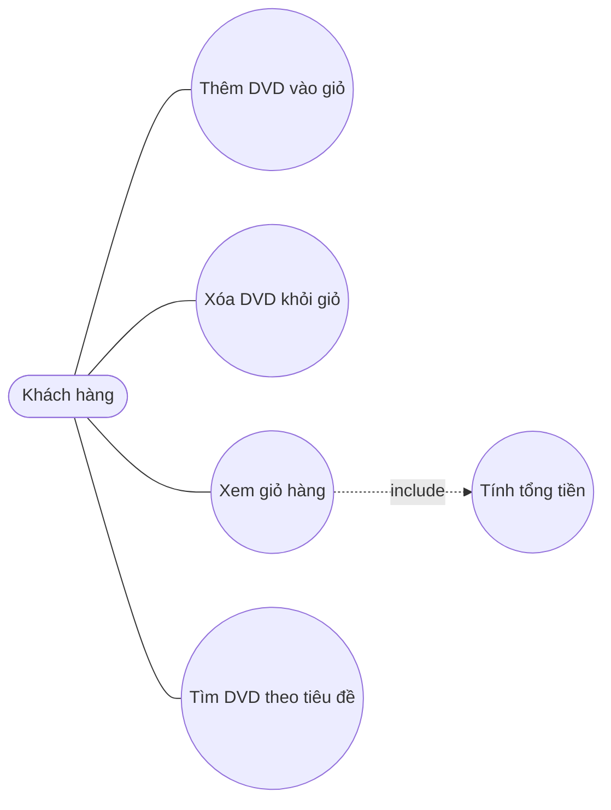

# Biểu đồ use case – AIMS-mini

| Use case | Mô tả | Hàm tương ứng |
|---|---|---|
| Thêm DVD vào giỏ | Giỏ chứa tối đa 20 đĩa | `Cart.add_dvd()` |
| Xóa DVD khỏi giỏ | Báo lỗi nếu đĩa không có trong giỏ | `Cart.remove_dvd()` |
| Xem giỏ hàng | In danh sách đĩa và tổng tiền | `Cart.print_cart()` |
| Tìm DVD theo tiêu đề | Lọc danh sách theo từ khóa | `search_by_title()` |
| Tính tổng tiền | Cộng giá các đĩa trong giỏ | `Cart.total_cost()` |
